# Blocky

opensource minecraft launcher. enjoy!

*the fold: backdrop pixels dissolve one by one into true transparency — no slides, no black box*

*backdrops: frosted glass, or Minecraft block textures read live from your own game files — press a swatch below to view one full-size*

| | | | |
|:---:|:---:|:---:|:---:|
| [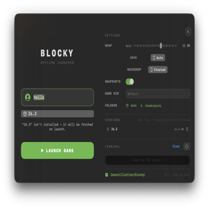](docs/backdrops/frosted.png) | [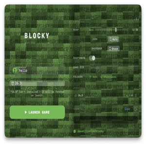](docs/backdrops/grass.png) | [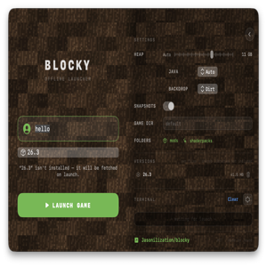](docs/backdrops/dirt.png) | [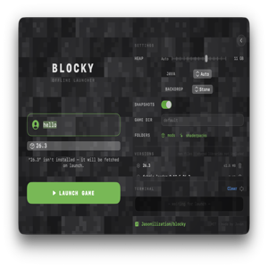](docs/backdrops/stone.png) |
| [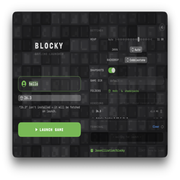](docs/backdrops/cobblestone.png) | [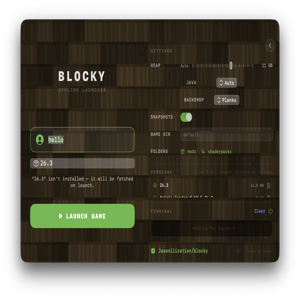](docs/backdrops/planks.png) | [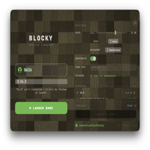](docs/backdrops/sandstone.png) | [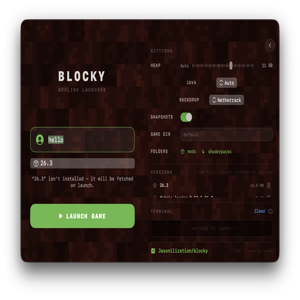](docs/backdrops/netherrack.png) |
| [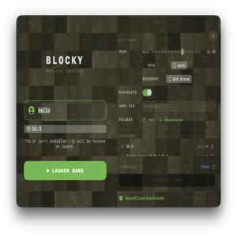](docs/backdrops/endstone.png) | [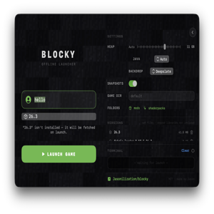](docs/backdrops/deepslate.png) | [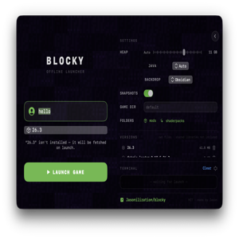](docs/backdrops/obsidian.png) | |

more info

## run

    git clone https://github.com/Jasonilization/blocky.git
    cd blocky
    ./Scripts/setup.sh        # brew + java + Rosetta + Blocky.app
    open Blocky.app

or build directly: `./Scripts/bundle.sh release` (Command Line Tools are enough — no Xcode needed). `./Scripts/dmg.sh` builds the drag-to-Applications installer.

## what's inside

- offline launch — no accounts, no telemetry; standard offline UUID (`UUID.nameUUIDFromBytes`-exact)
- picks up every version in `~/Library/Application Support/minecraft`, fetches missing ones (client + libraries + assets, sha1-verified) straight from Mojang
- auto Java detection (`java_home`, Homebrew openjdk, system JVMs) and the flags the game actually needs on macOS — `-XstartOnFirstThread` first among them; MoltenVK runs in low-latency IMMEDIATE present mode
- **mods**: Fabric / NeoForge profiles launch through `inheritsFrom` merging — drop `.jar`s in `mods/`, shader packs in `shaderpacks/`; both folders open straight from Settings
- pixel-dissolve fold-out panel: settings (heap slider, Java, backdrops, snapshots, game dir), version manager (sizes + delete), and a live log terminal with a focus mode
- version management with on-disk footprints and two-tap confirmed deletion; dual-launch protection
- idle cost: 0.0% CPU, ~42 MB, no timers, no polling

## for developers

    ./Scripts/swift-build.sh   # SDK pinning handled for CLT-only machines
    ./Scripts/swift-test.sh    # 25 tests / 9 suites

MIT — see [LICENSE](LICENSE). Made by [Jasonilization](https://github.com/Jasonilization).

